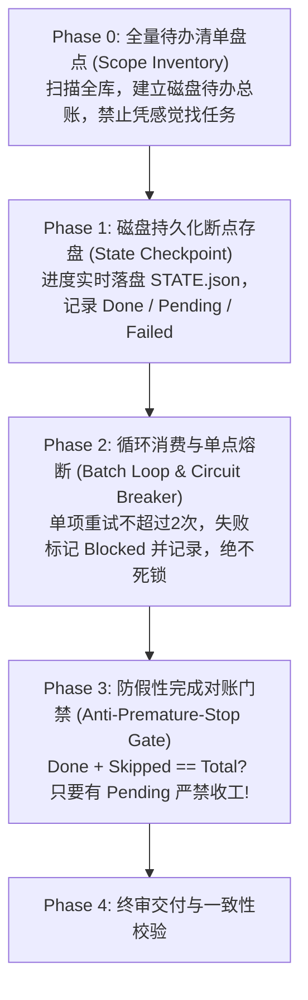

# Skill 架构模式、渐进式披露与大工程稳定性指南 (Structural Patterns)

高质量的 Skill 在组织结构上具有鲜明的模式化特征。选对骨架模式，是 Skill 具备清晰执行力的第一步；践行**渐进式披露（Progressive Disclosure）**，是控制 Token 消耗与避免模型认知过载的核心工程手段；**确保架构复杂度与目标野心严格对等**，是防止纸上谈兵的底线；而**设计长周期状态韧性与防假完成门禁**，则是支撑大项目稳定跑完一整天的定海神针。

---

## 一、四大经典骨架模式 (The 4 Archetypes)

| 模式类型 | 核心结构骨架 | 典型适用场景 | 官方代表样例 |
|:---|:---|:---|:---|
| **Workflow-based**<br>*(流程顺序型)* | `Overview` → `Workflow Decision Tree` → `Phase/Step 1` → `Phase/Step 2` → `Validation` | 任务具有强先后依赖关系，必须按部就班逐步推进（如文档转换、发布闭环、代码重构）。 | `docx`, `skill-optimizer` |
| **Task-based**<br>*(任务菜单型)* | `Overview` → `Quick Start` → `Task 1 (提取)` → `Task 2 (合并)` → `Task 3 (转换)` | 同一领域包含多种平级独立操作，用户按需调用其中某一项（如 PDF 处理、音频转码）。 | `pdf-processing`, `ffmpeg` |
| **Reference / Guidelines**<br>*(规范约束型)* | `Overview` → `Core Principles` → `Guidelines` → `Specific Rules` → `Actionable Checklist` | 固化标准、审美、设计规范、编码规范或安全准则，指导模型在既定框架内产出。 | `canvas-design`, `brand-guidelines` |
| **Capabilities-based**<br>*(系统能力型)* | `Overview` → `Role Definition` → `Core Capabilities` → `Capability Map` → `Combos` | 综合性业务领域（如敏捷项目管理、全栈架构师），由多个子能力有机组合。 | `product-manager`, `security-auditor` |

---

## 二、目标雄心与工程复杂度对等天平 (Proportionality Matrix)

在架构设计中，**架构复杂度必须与目标野心相称**，严防两类极端病态：
- ❌ **大炮打蚊子（过设计）**：简单单点任务却堆砌了四五个虚拟角色与层层门禁；
- ❌ **小马拉大车（纸上谈兵）**：目标定在火星（如“百万行代码全库深度重构”），却只写了一个孤零零的百行纯文本 `SKILL.md`，无配套资源、无模板、无状态机，模型缺乏支点必然口头糊弄。

```
任务目标野心量级                匹配的工程架构支撑
───────────────────────────────────────────────────────────────────────────
轻量级单点任务 (Lightweight)  ↔ 纯单文件 SKILL.md (≤200行)，敏捷无冗余
中量级专业任务 (Medium)       ↔ SKILL.md 导航 + references/ (字典/规范) + Checklist
宏大工程体系 (Heavyweight)    ↔ 阶段决策树 + 磁盘断点状态落盘 (STATE.json)
                                + assets/ (脚手架模板) + 脚本化分流 + 熔断自愈
```

---

## 三、长周期大项目稳定执行模式 (Long-Running Resilience Pattern)

针对需要执行数小时甚至整整一天的宏大项目任务（如全库扫描、微服务迁移、大型审计），**模型必然会面临上下文压缩（Context Compaction）、进程断开与假性完成幻觉**。必须内置以下四重稳定性设计：



### 1. 全量待办总账（Scope Inventory）
- 启动第一步必须先清点全量范围（如查出全部 180 个服务模块），写入物理清单；
- 杜绝“走一步看一步”式的随意执行。

### 2. 磁盘断点状态机（Disk-backed State Checkpoint）
- 严禁将任务进度寄生在脆弱的聊天上下文中；
- 每次完成一个子任务，必须即时更新磁盘状态文件（如 `STATE.json`）。进程中断重开或会话压缩后，Agent 只需重新读取状态文件即可无缝续跑。

### 3. 防假性完成对账门禁（Anti-Premature-Stop Gate）
- 严禁模型凭借口头感觉“我觉得做完了”宣布收工；
- 必须强制代码/数值对账：
  $$\text{已处理数 (Done)} + \text{标记跳过数 (Skipped)} == \text{总盘点数 (Total)}$$
  若有未完成项，门禁直接拦截打回，强迫模型继续推进。

### 4. 单点重试上限与熔断（Circuit Breaker）
- 单个子文件/模块失败，设置最大重试次数（≤ 2 次）；
- 超过上限立刻标记为 `BLOCKED` 并记入错误台账，跳过并继续处理下一个，绝不把一整天的 Token 消耗在单点死锁上。

---

## 四、渐进式披露原则 (Progressive Disclosure)

```
my-skill/
├── SKILL.md                 # 核心骨架（强烈建议 ≤ 500 行）
├── references/              # 深度背景、长 API 表、领域规范、长文解析
└── assets/ (或 templates/)  # 样板、模板代码、固定骨架资源、UI Boilerplate
```
- **禁止多层嵌套（禁止套娃）**：引用只允许 1 层（`SKILL.md` → `references/detail.md`），禁止多级链式跳转。

---

## 五、官方顶级 Skill 的 7 大高阶设计技法 (Advanced Craftsmanship)

1. **提高天花板**：不是画一张图，而是确立美学流派与算法体系（成体系输出）；
2. **双阶段结构**：抽象哲学/规范先行 → 代码/产物后置（杜绝陷入局部最优）；
3. **规范写作范本**：兼具诗性与工程化（多维度约束，每句直接映射数据结构）；
4. **概念种子深嵌**：将主题意图转化为物理参数、阈值与阻尼，而非粗暴堆砌文案；
5. **模版解耦 (FIXED vs VARIABLE)**：STEP 0 必须读模版，划清固定底线与自由发挥边界；
6. **专业匠心 Checklist 化**：把“高品质/优雅”翻译为不出血、无重叠、固定 Seed 的硬性清单；
7. **终审精修：做乘法不做加法**：收尾阶段阻断随意追加元素，强制微调已有关系与消灭冗余。
